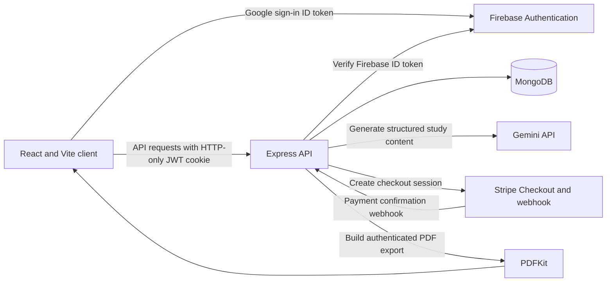

# PrepPilot AI

PrepPilot AI is an AI-assisted study workspace for creating structured exam notes, optional visual explanations, and downloadable study PDFs. It includes Google sign-in, saved notes, and credit-based generation.

## Features

- Google sign-in through Firebase Authentication.
- Exam-oriented notes with topic, class/level, exam, and revision options.
- Optional Mermaid diagrams and Recharts visualizations when returned by the AI provider.
- Saved-note history and PDF export.
- Credit balance and Stripe Checkout credit packs.
- Responsive interface for desktop and mobile.

One successful generation costs 10 credits. New accounts start with 50 credits. The current Stripe packs are 50 credits for INR 100, 120 credits for INR 200, and 300 credits for INR 500.

## Screenshots

Screenshots in this repository should be captured from the running app. The sign-in page can be viewed without a user account. The dashboard and study workspace require Firebase sign-in and are not represented with mock data.

**Desktop**


**Mobile**


## Technology

- Client: React 19, Vite 7, React Router, Redux Toolkit, Tailwind CSS 4, Motion, Firebase client SDK, Axios, Recharts, Mermaid, React Markdown.
- Server: Node.js ES modules, Express 5, Mongoose 9, Firebase Authentication REST verification, Gemini `generateContent`, Stripe, PDFKit, JWT in an HTTP-only cookie.
- Database: MongoDB.

## Architecture



The client uses Firebase Popup sign-in, sends the resulting Firebase ID token to the API, and receives a signed HTTP-only session cookie after server-side identity verification. Notes and credit changes are processed by the API; Gemini and Stripe credentials remain on the server.

## Local setup

Use Node.js 20 or newer. Install dependencies in each app directory:

```powershell
cd client
npm install

cd ..\server
npm install
```

Configure `client/.env`:

```dotenv
VITE_FIREBASE_APIKEY=your_firebase_web_api_key
VITE_SERVER_URL=http://localhost:8000
```

`VITE_SERVER_URL` is optional when using the default local API address. Firebase client configuration also includes the existing Firebase project identifiers in `client/src/utils/firebase.js`.

Configure `server/.env`:

```dotenv
PORT=8000
CLIENT_URL=http://localhost:5173
MONGODB_URL=mongodb+srv://<user>:<password>@<cluster>/<database>
JWT_SECRET=replace_with_a_long_random_value
FIREBASE_API_KEY=your_firebase_web_api_key
GEMINI_API_KEY=your_gemini_api_key
STRIPE_SECRET_KEY=your_stripe_secret_key
STRIPE_WEBHOOK_SECRET=your_stripe_webhook_secret
```

`FIREBASE_API_KEY` is the Firebase Web API key for the same project used by the client; it is used by the server to verify Firebase ID tokens. Configure the Identity Toolkit API for this key. Keep `GEMINI_API_KEY`, `STRIPE_SECRET_KEY`, `STRIPE_WEBHOOK_SECRET`, `JWT_SECRET`, and `MONGODB_URL` private. Do not commit either `.env` file.

In two terminals, start the client first and then the API:

```powershell
cd client
npm run dev
```

```powershell
cd server
npm run dev
```

Open `http://localhost:5173`. Configure Firebase Authentication with Google as a provider and add the local client origin to the Firebase authorized domains. To test credit purchases, configure Stripe Checkout and send the `checkout.session.completed` event to `http://localhost:8000/api/credits/webhook` using Stripe CLI or a configured webhook endpoint.
The webhook uses a MongoDB transaction and needs a replica-set deployment; MongoDB Atlas provides this.

## Quality checks

```powershell
cd client
npm run lint
npm run build

cd ..\server
npm test
```

The server tests use Node's built-in test runner and do not call Firebase. A real Google sign-in, Gemini generation, MongoDB persistence, and Stripe payment require valid service configuration.

## Architecture and implementation notes

- `client/src/App.jsx` owns routes and restores the current session on load.
- `client/src/pages/` contains sign-in, dashboard, note creation, library, and payment status pages.
- `client/src/services/` contains API and server URL configuration.
- `server/routes/` maps HTTP routes to controllers; `server/controllers/` handles authentication, notes, credits, and PDFs.
- `server/services/` calls Firebase identity verification and Gemini.
- `server/models/` defines Mongoose user and notes records.

## Current limitations

- There is no separate project-notes workflow; the current generator creates topic-based study notes with optional exam context.
- AI output is generated dynamically and may need checking against course material. Charts are requested only when quantitative information can be supported.
- Checkout and live AI generation cannot be validated without valid Firebase, MongoDB, Gemini, and Stripe configuration.
- No authenticated dashboard screenshot is included because it depends on an actual Google sign-in.
- The project has no configured deployment, CI pipeline, or end-to-end browser test suite.
