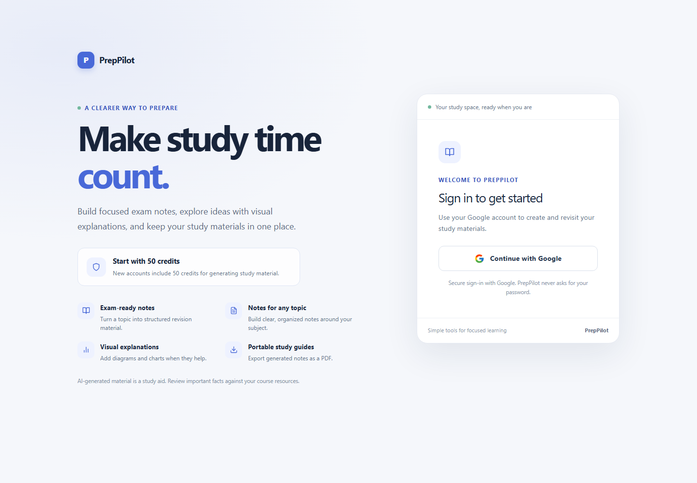
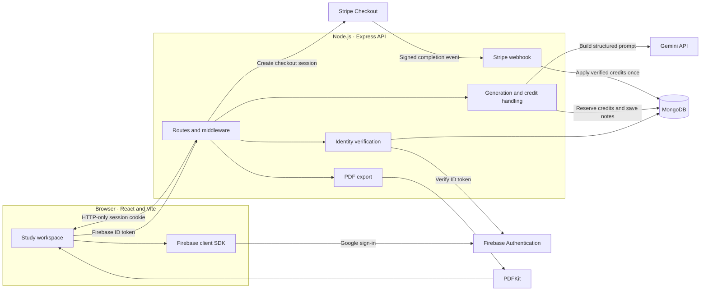

<div align="center">

# PrepPilot AI

### Turn a study topic into a structured, reusable exam revision guide.

PrepPilot AI is a full-stack study workspace for generating topic-focused notes with optional revision summaries, questions, diagrams, and charts. Students can save generated material, revisit it later, export it as a PDF, and manage usage through an account-based credit system.

<p>
  
  
  
  
  
</p>

</div>

---

## At a glance

PrepPilot takes a topic and optional study context, asks Gemini for a structured response, and presents the result in a workspace designed for review. The output can include explanatory notes, prioritised subtopics, short- and long-answer practice questions, a revision checklist, and optional visual aids.

The application is split into two independently run parts:

- **Client:** A React single-page application for signing in, preparing a generation request, viewing saved study material, and managing credits.
- **API:** An Express service that verifies identity, checks credits, requests AI-generated content, stores notes, creates PDF files, and handles payment events.

PrepPilot is an educational support tool—not a source of guaranteed exam predictions. Generated material should be checked against the student's syllabus and trusted course resources.

## Product tour

1. **Sign in with Google.** Firebase authenticates the user. The client sends the resulting ID token to the API, which verifies it before creating a PrepPilot session.
2. **Describe what you are studying.** Enter a topic and, if useful, a class or level and an exam or curriculum.
3. **Choose the format.** Turn on revision mode for a concise review, or request a diagram or chart when a visual would help.
4. **Review the result.** Generated notes are organised with topic priorities, practice questions, revision points, and any supported visual content.
5. **Keep or export your work.** Saved notes appear in the user's history and can be downloaded as a PDF.
6. **Manage usage.** Each successful generation costs 10 credits. New accounts start with 50 credits. Optional Stripe checkout plans add credits after the server verifies a completed payment event.

### Capabilities

| Area | What it does |
| --- | --- |
| Topic-based notes | Generates Markdown study material from a required topic and optional level and exam context. |
| Revision mode | Requests compact, one-line revision points rather than extended explanations. |
| Practice questions | Includes short-answer and long-answer questions in the generated response. |
| Diagrams | Can request a Mermaid flowchart for a concept or process. |
| Charts | Can request a bar, line, or pie chart; the prompt directs the model not to invent numerical facts. |
| Saved library | Stores generated notes in MongoDB so the signed-in user can revisit them. |
| PDF export | Produces a downloadable study guide from note content on the server. |
| Credits and checkout | Reserves credits for generation and supports INR credit packs through Stripe Checkout. |
| Responsive interface | Provides layouts for both desktop and smaller screens. |

> **Credit packs:** The current checkout offers 50 credits for INR 100, 120 credits for INR 200, and 300 credits for INR 500. One note-generation request costs 10 credits. Checkout and prices require correctly configured Stripe credentials.

## Screenshots

The desktop image below was captured from the running sign-in page. Authenticated screens are intentionally not represented with invented or sample account data.

### Desktop



### Mobile

> _Mobile screenshot placeholder — a captured mobile view will be added here._

## How the pieces fit together



### Sign-in and session

The browser uses Firebase Popup sign-in and obtains a Firebase ID token. It sends that token to `POST /api/auth/google`; the server verifies the token with Firebase's Identity Toolkit API before upserting the user and issuing a signed, HTTP-only `token` cookie. Subsequent API requests include that cookie. The browser does not choose or submit a trusted user ID.

### Notes and credit handling

The generation route checks the request fields and authenticated user, then atomically reserves 10 credits before calling Gemini. On a successful response, the API validates the expected response shape, stores the note, and returns the remaining balance. If generation fails after the reservation, the server attempts to refund the reserved credits.

### Checkout

The API creates a Stripe Checkout session for one of the configured INR plans. Stripe sends payment confirmation to a raw-body webhook route. The webhook validates Stripe's signature and payment metadata, then uses a MongoDB transaction and a processed-payment record to avoid crediting the same checkout session more than once.

## Technology

| Layer | Technologies |
| --- | --- |
| Client application | React 19, Vite 7, React Router, Redux Toolkit |
| UI and visualisations | Tailwind CSS 4, Motion, React Icons, Recharts, Mermaid, React Markdown |
| Client networking and identity | Axios, Firebase JavaScript SDK |
| API | Node.js ES modules, Express 5, cookie-parser, CORS |
| Persistence | MongoDB with Mongoose 9 |
| AI content | Gemini `generateContent` API |
| Billing | Stripe Checkout and signed webhooks |
| Document output | PDFKit |
| Automated tests | Node.js built-in test runner |

## Repository layout

```text
.
├── client/
│   ├── public/                 # Static assets and favicon
│   └── src/
│       ├── components/         # Shared interface and note-generation UI
│       ├── pages/              # Authentication, dashboard, notes, history, pricing
│       ├── redux/              # User and credit state
│       ├── services/           # API client and server URL configuration
│       └── utils/              # Firebase client setup
├── docs/
│   └── screenshots/            # Captured product screenshots
└── server/
    ├── controllers/            # Authentication, generation, notes, PDF, credits
    ├── middleware/             # Session authentication and database readiness
    ├── models/                 # User, notes, and processed-payment records
    ├── routes/                 # Express route definitions
    ├── services/               # Firebase token verification and Gemini requests
    ├── tests/                  # Server unit tests
    └── utils/                  # MongoDB connection, prompts, and token helpers
```

## Run locally

### Requirements

- Node.js 20.19 or newer (or 22.12 or newer) and npm.
- A MongoDB deployment. Stripe credit processing uses transactions, so use a replica set (MongoDB Atlas deployments provide this).
- A Firebase project with Google Authentication enabled.
- A Gemini API key for note generation.
- A Stripe secret key for the current API configuration; a webhook signing secret is also needed to process payment events.

### 1. Install dependencies

Run these commands from the repository root in PowerShell:

```powershell
cd client
npm ci

cd ..\server
npm ci
```

### 2. Configure local environment

Create `client/.env`:

```dotenv
VITE_FIREBASE_APIKEY=your_firebase_web_api_key
VITE_SERVER_URL=http://localhost:8000
```

`VITE_SERVER_URL` can be omitted when using the default local address. The remaining Firebase project identifiers are set in `client/src/utils/firebase.js`.

Create `server/.env`:

```dotenv
PORT=8000
CLIENT_URL=http://localhost:5173
MONGODB_URL=mongodb+srv://<user>:<password>@<cluster>/<database>
JWT_SECRET=replace_with_a_long_random_value
FIREBASE_API_KEY=your_firebase_web_api_key
GEMINI_API_KEY=your_gemini_api_key
STRIPE_SECRET_KEY=your_stripe_secret_key
STRIPE_WEBHOOK_SECRET=your_stripe_webhook_secret
```

`FIREBASE_API_KEY` must belong to the same Firebase project used by the client. Enable the Identity Toolkit API for the key. Set the Google provider to enabled in Firebase Authentication and allow `localhost` in its authorised domains.

Keep both `.env` files private. Do not put Gemini, Stripe, MongoDB, or JWT secrets in client-side environment variables, screenshots, issues, or commits. The root and app-level Git ignore rules exclude local environment files.

### 3. Start the client, then the API

Open two terminals from the repository root. Start the client first:

```powershell
cd client
npm run dev
```

Then start the API in the other terminal:

```powershell
cd server
npm run dev
```

Open [http://localhost:5173](http://localhost:5173). The API health check is available at [http://localhost:8000/](http://localhost:8000/).

If MongoDB is unreachable, the server logs a connection failure and database-dependent endpoints return a temporary-unavailable response. Check the connection string, database credentials, and network allow-list rather than disabling authentication or persistence.

### Optional: test Stripe locally

Configure Stripe test-mode credentials and `STRIPE_WEBHOOK_SECRET`. Forward Stripe's `checkout.session.completed` event to:

```text
http://localhost:8000/api/credits/webhook
```

For example, use the Stripe CLI's webhook forwarding command and its printed signing secret. The webhook is registered before Express JSON parsing so Stripe's signature can be verified against the raw request body.

## API overview

All paths below are relative to the API origin (default `http://localhost:8000`). Protected endpoints require the PrepPilot session cookie.

| Method | Path | Purpose |
| --- | --- | --- |
| `GET` | `/` | API health response. |
| `POST` | `/api/auth/google` | Verify a Firebase ID token and create a PrepPilot session. |
| `GET` | `/api/auth/logout` | Clear the session cookie. |
| `GET` | `/api/user/currentuser` | Restore the current signed-in user and credit balance. |
| `POST` | `/api/notes/generate-notes` | Generate and save notes; consumes 10 credits on success. |
| `GET` | `/api/notes/getnotes` | List the signed-in user's saved notes. |
| `GET` | `/api/notes/:id` | Retrieve one of the signed-in user's notes. |
| `POST` | `/api/pdf/generate-pdf` | Create a PDF from supplied study content. |
| `POST` | `/api/credit/order` | Create a Stripe Checkout session for a credit pack. |
| `POST` | `/api/credits/webhook` | Receive and verify Stripe payment events. |

Generation accepts `topic` (required; up to 160 characters), optional `classLevel` and `examType` (up to 80 characters each), and boolean `revisionMode`, `includeDiagram`, and `includeChart` options.

## Quality checks

Run the client checks:

```powershell
cd client
npm run lint
npm run build
```

Run the server tests:

```powershell
cd server
npm test
```

The server test suite uses Node's built-in test runner and covers Firebase ID-token verification behaviour without contacting Firebase. A successful build or unit test run does not replace end-to-end testing against configured Firebase, MongoDB, Gemini, and Stripe services.

## Project status and limitations

- This repository contains the application source; it does not currently include a configured deployment or CI pipeline.
- Real Google sign-in requires Firebase configuration, and account creation and saved notes require a reachable MongoDB database.
- Gemini output is model-generated and can be incomplete or incorrect. Review it against authoritative course material before relying on it.
- Charts are optional and should only be used when the returned content includes suitable quantitative data; they are not exam-weightage predictions.
- An authenticated dashboard screenshot is not included because it should be captured from a real signed-in session.
- There is no separate project-notes workflow; the current study flow creates notes from a topic and optional exam context.

## Contributing

If you are opening an issue or proposing a change, include the relevant route or screen, steps to reproduce where applicable, and the checks you ran. Never include API keys, database connection strings, session cookies, or personal account data in a report.
